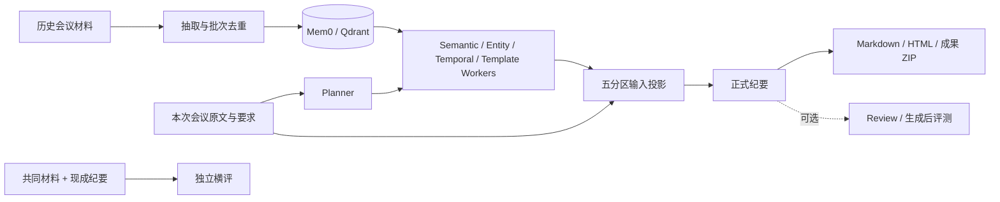

# 小艺慧记 · 会议记忆工作台

> 面向连续会议的多 Agent 纪要系统：从历史材料提取长期记忆，在新会议中检索相关事实、解析时间、选择模板，生成可追溯的纪要与成果包。

[](https://www.python.org/) [](https://www.gradio.app/) [](https://qdrant.tech/)

[核心能力](#核心能力) · [系统设计](#系统设计) · [快速开始](#快速开始) · [评测与产物](#评测与产物) · [测试](#测试) · [使用边界](#使用边界)

---

## 问题与目标

一场项目会议往往延续前几次的任务、约束和风险。只把本次原文交给模型，容易漏掉历史背景；把所有历史原文一起交给模型，又会扩大上下文、混淆新旧状态。

本项目把这件事拆为两个可维护的过程：**历史材料形成 Typed Memory**，新会议由 **Planner 和专业 Worker 按需检索、选择和解释**，最终合成器只接收当前原文、相关历史、时间结果、任务要求和模板。完整证据与执行轨迹另存为审计产物。

这是可运行的研究与演示系统。历史检索是否发生由 Planner 决定；记忆、模型判断和来源定位都不能替代人工事实核查。

## 核心能力

| 功能 | 用户操作 | 主要产物 |
| --- | --- | --- |
| **资料导入** | 上传或粘贴过往会议，填写材料日期 | 六类 Typed Memory、去重报告和导入记录 |
| **生成纪要** | 提供本次原文、日期与纪要重点，可指定场景 | 正式 Markdown；可选行动、风险、历史延续、来源与离线 HTML |
| **纪要横评** | 用共同材料比较 2–5 份现成纪要 | 精简或严格评测报告；首份仅作差值基线 |
| **结果中心** | 查看运行状态、正式结果和处理详情 | 可下载成果与完整审计产物 |

会议场景支持**自动选择、通用会议、项目例会、决策评审、专项讨论**；正文支持结构化和自然叙述。Web 默认使用 `cloud_fast` 流程及丰富成果模式，也保留 `legacy` 兼容流程。

## 系统设计



### 从历史到本次纪要

1. **提取**：按来源日期把历史原文分块，抽取任务、决定、约束、风险、时间和偏好；跨块候选经保守去重后写入 Memory。
2. **规划与执行**：Planner 决定任务和依赖。Semantic 检索相关历史，Entity 处理实体线索，Temporal 解析本次时间表达，Template 确定输出格式。
3. **选择与合成**：Semantic 可在检索结果中选择单条 Memory；输入投影将同一记录的重复呈现折叠。最终模型看到完整本次原文一次，以及最终可见的历史业务内容、时间结果和模板。
4. **交付与审计**：丰富模式先生成结构化文档，再由程序派生正式 Markdown、行动与风险视图、历史延续视图、来源附件和离线 HTML。工具原始返回、Evidence、状态与模型输入长度保留在运行目录。

| 路径 | `cloud_fast`（Web 默认） | `legacy` |
| --- | --- | --- |
| 历史导入 | 直接抽取 Typed Memory，再去重写入 | 保留基础摘要生成路径 |
| 纪要生成 | Planner/Workers 后合成，默认跳过前置 Current Fact Mapper | 保留 Mapper、grounding 与覆盖检查 |
| 深度审核 | 显式开启时恢复审核需要的 Mapper | 保留原审核行为 |
| 精简评测 | 输入允许时整份抽取参考事实 | 保留原固定分块默认值 |

`cloud_fast` 省去前置 Mapper，并不表示纪要已通过事实核验。相关实现见 [架构说明](scripts/agent/SUMMARY_MULTI_AGENT_ARCHITECTURE_V2_ZH.md)。

## 快速开始

### 1. 准备环境

需要 Python 3.10+、本地可用的 Embedding 模型，以及 Mem0/Qdrant 依赖。外部生成模型不要求在本机启动 vLLM。

```bash
git clone https://github.com/miracle-orange/mem0-summary-agent.git
cd mem0-summary-agent
python -m pip install -r scripts/agent/requirements-summary-web.txt
```

Web requirements **并非完整环境锁文件**；全新机器还需安装 `mem0ai` 及对应 Qdrant、Embedding 依赖，并准备本地模型。已有环境和记忆库可直接复用，无需重新导入。不要把运行用的模型目录或数据库提交到仓库。

### 2. 配置模型与记忆库

复制 [`.env.example`](.env.example) 为 `.env`，填写实际模型服务和本机目录：

```dotenv
SMW_LLM_BACKEND=openai_compatible
OPENAI_BASE_URL=https://api.deepseek.com
OPENAI_API_KEY=替换为自己的密钥
OPENAI_MODEL=替换为服务商提供的模型ID
SMW_EXECUTION_PROFILE=cloud_fast

MEM0_SUMMARY_ROOT=/你的/仓库路径
MEM0_MODEL_ROOT=/你的/模型目录
MEM0_EMBEDDING_MODEL=/你的/Embedding模型路径
MEM0_QDRANT_SUMMARY_PATH=/你的/持久化目录/qdrant_summary
MEM0_SUMMARY_COLLECTION=你的集合名
```

支持 DeepSeek、SiliconFlow 等兼容 Chat Completions 的服务；`OPENAI_BASE_URL` 和模型 ID 应以服务商实际配置为准。进程环境变量优先于 `.env`。`.env` 已被 Git 忽略，不要提交真实密钥。外部 API 默认流式接收，完整结果收齐后才交给业务流程。

### 3. 启动 Web

```bash
python scripts/agent/summary_multi_agent_web_demo.py \
  --host 127.0.0.1 \
  --port 7863 \
  --output-dir outputs/meeting_workspace
```

本机访问 `http://127.0.0.1:7863`。在 Jupyter 代理环境额外传入**当前环境的** `--root-path /<代理前缀>/proxy/7863`，不要复用旧服务器的代理路径。远程访问需自行提供身份认证和网络隔离。

### 4. 完成一次连续会议流程

1. 顶部填写**所属项目**和**记忆身份**，两次会议保持同一身份、项目和 Memory 集合。
2. 在“资料导入”上传历史材料，填写来源日期，执行“提取并保存”；已有历史可跳过。
3. 在“生成纪要”输入本次原文和日期，写明纪要重点，选择场景、表达方式与成果形式。
4. 在“结果中心”查看正式纪要、行动与风险、历史延续及来源；也可用“纪要横评”比较现成纪要。

历史库**可使用**不代表本轮**实际检索成功**。请以该次运行的计划、Worker 结果和历史选择报告为准。

### 命令行示例

```bash
python scripts/agent/summary_multi_agent_demo.py \
  --current-file path/to/current.md \
  --user-id example_user --project example_project \
  --source-time 2026-10-21 \
  --summary-request "生成项目例会纪要，突出进展、风险与后续行动" \
  --minutes-output-mode rich \
  --output-dir outputs/meeting_cli
```

独立横评：

```bash
python scripts/agent/summary_multi_agent_evaluation_demo.py \
  --project example_project \
  --summary-request "生成项目例会纪要" \
  --current-file path/to/current.md \
  --current-source-time 2026-10-21 \
  --summary "direct|直接生成|path/to/direct.md" \
  --summary "multi|多代理|path/to/multi.md" \
  --evaluation-mode lite \
  --output-dir outputs/meeting_compare
```

## 评测与产物

| 模式 | 回答的问题 | 使用范围 |
| --- | --- | --- |
| **精简评测** | 当前重要事实覆盖了多少？候选事实是否受到所给材料支持？ | 在线评测或独立横评；调用更少 |
| **严格评测** | 更细的事实、历史状态和双范围对照如何？ | 在线评测或独立横评；耗时更长 |

精简模式由模型抽取参考事实和候选原子事实，再批量匹配与判断支持性，指标由程序计算。正常调用数为 `K + 3N`（`K` 为参考事实抽取次数，`N` 为候选纪要数）；分块与修复另计。不同评测模式的指标口径不可直接互换。独立横评不访问 Qdrant，需要用户明确提供历史原文。

| 运行文件 | 说明 |
| --- | --- |
| `summary_multi_agent.md` | 正式纪要，candidate 0 |
| `minutes_document.json`、`minutes_report.html` | 丰富成果的结构化数据与离线阅读页 |
| `minutes_sources.json`、`minutes_report_bundle.zip` | 来源定位与业务成果包 |
| `plan.json`、`agent_results.json`、`execution_trace.jsonl` | 规划、Worker 结果与执行轨迹 |
| `history_selection_report.json`、`model_input_report.json` | 历史可见集合与合成输入长度 |
| `evaluation_lite_result.json` | 开启精简评测时的指标结果 |

来源能逐字定位，只说明字符串位置可恢复，**不等于语义事实已经核验**。原始运行目录可能含完整材料、Prompt 和模型响应，应按敏感数据管理。

## 项目结构

```text
scripts/agent/
├── summary_multi_agent_web_demo.py         # 四页 Gradio 工作台
├── summary_multi_agent_demo.py             # 纪要生成 CLI
├── summary_multi_agent_evaluation_demo.py  # 独立横评 CLI
├── summary_memory_llm.py                   # 模型服务适配
├── summary_multi_agent/
│   ├── evaluation/lite/                    # 精简评测核心
│   └── minutes_report/                     # 结构化成果与渲染
├── summary_multi_agent_web/                # Web 请求、运行管理与展示
├── eval_inputs/                            # 固定示例材料
└── tests/                                  # 回归测试
```

`outputs/`、`qdrant_summary/`、`models/` 和 `.env` 不属于版本控制。同步代码不会同步 Memory、模型权重或服务器配置。

## 测试

在已安装项目依赖的环境中，从仓库根目录运行：

```bash
PYTHONPATH=scripts/agent python -m pytest -q scripts/agent/tests \
  scripts/agent/test_summary_memory_llm.py \
  scripts/agent/test_summary_memory_typed_memory.py \
  scripts/agent/test_summary_memory_case_demo.py
```

## 文档

| 主题 | 入口 |
| --- | --- |
| 多 Agent 数据流与协议 | [架构说明](scripts/agent/SUMMARY_MULTI_AGENT_ARCHITECTURE_V2_ZH.md) |
| 外部 API 配置 | [环境变量示例](.env.example) |
| 精简评测 | [评测设计](scripts/agent/SUMMARY_MULTI_AGENT_LITE_EVALUATION_ZH.md) |

## 使用边界

- 外部 API 会收到当前材料、被选中的历史业务信息及相关 Prompt。上传业务资料前，请确认它们获准发送给所选服务。
- 历史 Memory 是从材料抽取的记录，不等于重新核验过的历史原文；过去的状态不能自动当作本次状态。
- `cloud_fast`、结构化输出及来源面板都不能保证事实正确。重要纪要应人工检查负责人、日期、决定与行动范围。
- 本仓库尚未包含许可证文件。公开可见与获准复制、修改、再发布是两回事；对外复用前需明确许可安排。
